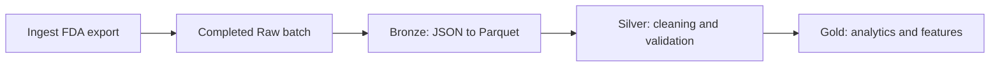

# openFDA Pipeline Design Doc

## Architecture Overview

The pipeline follows a four-stage data processing architecture: **Raw → Bronze → Silver → Gold**.

Each stage has a distinct responsibility, separating source preservation, storage optimization, data cleaning, and application-specific transformations.

Tasks form a DAG around these data layers. Ingestion publishes a completed Raw
batch; the independent Bronze node converts that batch without downloading data.
Bronze Parquet is a shared input for downstream Python or SQL/dbt tasks, each
owning its outputs. dbt requires a SQL engine that can access the Parquet data.
No orchestration framework is required by the conversion implementation.

### Raw Layer — Source Preservation

**Purpose:** Preserve original openFDA API responses exactly as received to ensure reproducibility, traceability, and recoverability.

**Responsibilities:**
- Store unmodified JSON responses from the openFDA API.
- Organize files by endpoint, ingestion date, and batch.
- Maintain ingestion metadata separately, including timestamps, source endpoints, and batch identifiers.
- Retain historical source responses to support reprocessing and auditing.

**Output:** Immutable, original JSON files.

#### Device enforcement ingestion node

- Implemented in `ingestion/device_enforcement.py`, callable through
  `ingest_device_enforcement(output_dir=Path("data/raw"), force=False)` or `ingest`.
  `backfill` delegates to the same downloader with `force=True`.
- Fetch the FDA download manifest and select all `/device/enforcement` partitions.
  Bulk updates are complete snapshots, including possible historical corrections.
- Match previous exports by export date, partition URLs, and record counts.
  Before skipping a matching completed batch, verify its local file checksums
  and metadata counts. These checks do not detect remote content revisions under
  an unchanged advertised identity; `--force` captures a fresh snapshot when needed.
- Preserve JSON bytes, validate ZIP integrity and counts, discard ZIPs, and publish
  only completed batches. Stage under `.ingest-*`; retain older snapshots unchanged.
- Stamp ingestion dates and timestamps in UTC using the existing Raw directory
  and metadata contract. Return the new batch path for downstream DAG tasks, or
  `None` when no new snapshot was published. Failure raises an error or exits
  nonzero from the CLI, leaving existing batches intact.
- Perform no format conversion or cleaning and invoke no downstream tasks.
  A future orchestrator passes the returned path to Bronze and retries failed
  downstream processing using the already published Raw batch. Scheduling is
  external to this node.

### Bronze Layer — Format Conversion

**Purpose:** Convert raw JSON records into a structured, columnar storage format for efficient downstream processing.

**Responsibilities:**
- Parse raw JSON responses and extract individual records.
- Convert JSON records into Apache Parquet format.
- Preserve source fields and values without applying business logic or data cleaning.
- Retain source identifiers and references to original raw files.
- Record schema information and conversion metadata.

**Output:** Parquet datasets representing the original source records.

#### Device enforcement conversion contract

- Implemented by `bronze/raw_to_bronze.py`, callable as
  `convert_batch(raw_batch_dir, output_dir)` or through `bronze --raw-batch ...`.
- The bare `bronze` command discovers completed batches under `data/raw/` and
  converts the sole batch missing its published Bronze counterpart. No pending
  batches is a successful no-op; multiple pending batches require explicit
  `--raw-batch` selection. Discovery uses the selected `--output-dir` root,
  ignores staging directories, and rejects existing destinations without
  conversion metadata. Explicit conversion remains available for DAG execution.
- Read files in ingestion-manifest order and verify SHA-256 checksums and file,
  partition, and batch counts. Process one JSON file at a time and write one
  Snappy-compressed Parquet file per source file.
- Schema version 1 covers all 25 observed source fields: 24 nullable strings and
  `openfda` encoded as nullable JSON text. Preserve dates, identifiers, blanks,
  whitespace, duplicate records, and row order. Reject unknown fields and
  incompatible non-null types pending an explicit schema update.
- Encode empty `openfda` objects as `"{}"`. Missing known fields and explicit JSON
  nulls become Parquet nulls; Raw remains authoritative for that distinction.
  Decode populated annotations with JSON when needed downstream.
- Add `_source_batch_id`, `_source_file`, and zero-based `_source_record_index`
  columns. Store source checksums, file mappings, counts, schema/version,
  converter/PyArrow versions, and UTC conversion timestamps separately in
  `conversion_metadata.json`.
- Mirror the Raw ingestion date and batch ID below
  `data/bronze/device_enforcement/`. Stage conversion outside Raw, validate each
  Parquet file by reading its schema and rows, then publish the complete batch
  with a directory rename. On failure, discard staging files. Reject existing
  output batches without overwriting them.
- Apply no cleaning or business-rule filtering. Silver performs standardization,
  deduplication, date parsing, and quality policies; Gold produces analytics and
  application-specific transformations.

### Silver Layer — Data Cleaning and Standardization

**Purpose:** Transform Bronze records into consistent, validated, analysis-ready datasets.

**Responsibilities:**
- Deduplicate records using appropriate source identifiers and versioning rules.
- Enforce data types, including dates, numeric fields, and categorical attributes.
- Handle missing values through documented, field-specific policies.
- Standardize manufacturer names, device categories, and relevant text fields.
- Validate data integrity, schema consistency, and accepted values.
- Flag or quarantine records that fail critical data quality checks.

**Output:** Cleaned and standardized Parquet tables.

#### Device enforcement Silver contract

- `silver/device_enforcement.py` exposes `clean_batch(bronze_batch_dir,
  output_dir=Path("data/silver"))`. The `silver` CLI discovers one pending completed
  Bronze snapshot; `--bronze-batch` selects explicitly and `--output-dir` changes
  the destination root. No pending batches is a successful no-op; several require
  selection. Existing output batches are never overwritten.
- Validate the Bronze endpoint, batch identity, schema version, file schemas,
  declared counts, and source provenance. Read only manifest-listed files with
  Hive inference disabled. Source-file/record-position pairs must be unique.
  Broken input contracts fail the entire run before publication.
- Execute packaged `standardize.sql`, `enforce_types.sql`, `validate.sql`, and
  `deduplicate.sql` in order within one in-memory DuckDB connection. Python owns
  batch handling, metadata, checks, and publication.
- Rules version 1 recognizes Unicode whitespace, converts whitespace-only strings
  to nulls, and trims identifiers,
  categories, addresses, and location fields. Preserve literal `N/A` and nonblank
  narrative/code/quantity/distribution text. Preserve the manufacturer display
  value and add `recalling_firm_normalized` with lowercase and collapsed whitespace.
  Keep identifiers/postal codes as strings and `openfda` as its original JSON text.
- Parse the four source dates (`report_date`, `recall_initiation_date`,
  `center_classification_date`, `termination_date`) as nullable `DATE` values,
  requiring eight-digit `YYYYMMDD` syntax and a valid calendar date. Preserve the
  original strings in corresponding `_raw` columns. Other source fields remain
  nullable strings. Perform no imputation.
- Quarantine missing recall numbers (`missing_recall_number`), missing source
  report dates (`missing_report_date`), and supplied unparseable dates
  (`invalid_<field>`). Optional missing dates and classifications remain null.
- Retain warning-only records: `initiation_before_2004`,
  `report_before_initiation`, `missing_event_id`, `unfamiliar_classification`,
  and `unfamiliar_status`. Recognize `Class I`, `Class II`, `Class III`,
  `Not Yet Classified`, and statuses `Ongoing`, `Completed`, `Terminated`.
  `_error_codes` and `_warning_codes` are non-null string lists.
- Within a snapshot, group by standardized nonempty recall number and compare
  all original Bronze source fields, excluding provenance. Collapse exact valid
  copies using source filename then record index as the deterministic order.
  Audit redundant copies with their provenance and retained-row references.
  Quarantine all conflicting versions (`conflicting_recall_number`), and preserve
  every critically invalid copy in quarantine. Apply no cross-snapshot precedence.
- Mirror the source ingestion date and batch ID under
  `data/silver/device_enforcement/`. Publish `accepted.parquet`,
  `quarantine.parquet`, `duplicates.parquet`, and `silver_metadata.json`.
  Accepted/quarantined records retain cleaned values, original date strings,
  quality codes, and Bronze provenance. The duplicate audit contains recall number,
  source provenance, `_kept_source_file`, and `_kept_source_record_index`.
- Require input count = accepted + quarantined + redundant copies. Write typed
  empty outputs, verify readback schemas/counts and accepted-key uniqueness, then
  publish by directory rename. Metadata includes input/output hashes, counts,
  quality summaries, UTC times, schema/rule versions, SQL hashes, and tool versions.
  Preserve Bronze unchanged and discard staging on failure.
- Silver publishes cleaned snapshots. Entity resolution, cross-snapshot update
  acceptance, and a reconciled current table remain separate tasks.

### Gold Layer — Analytics and Business Logic

**Purpose:** Create curated datasets supporting domain-specific analytics, machine learning, and application features.

**Responsibilities:**
- Aggregate recall records by manufacturer, device category, classification, and time period.
- Calculate metrics and trends in reported recall activity.
- Generate machine learning features from structured and unstructured fields.
- Prepare model-ready datasets, including target variables and temporally appropriate training splits.
- Store model predictions and associated metadata.
- Create application-specific tables for dashboards and analytical queries.

**Output:** Curated analytical tables, ML feature datasets, and prediction results.

#### Device enforcement Gold contract

- `gold/device_enforcement.py` exposes `build_gold(silver_batch_dir,
  output_dir=Path("data/gold"))`, also exported from `openFDA_pipeline.gold`.
  `gold` discovers the sole pending completed Silver batch; `--silver-batch`
  selects explicitly and `--output-dir` changes the destination. No pending
  batches is a successful no-op; several require explicit selection.
- Read only `accepted.parquet`, with Hive inference disabled. Verify Silver
  metadata identity/version/counts, accepted-file SHA-256, the Silver v1 schema,
  unique recall numbers and source positions, provenance, required dates, JSON
  annotations, and quality codes. Accepted warnings remain included. Quarantine
  and duplicates contribute no analytical records.
- Execute packaged `recall_detail.sql` and `summaries.sql` using in-memory DuckDB.
  Mirror ingestion date and batch ID below `data/gold/device_enforcement/`.
  Preserve Silver and earlier Gold outputs; reject an existing destination.
  Stage outside Silver and atomically rename only after Parquet schema, row,
  key, and recall-count reconciliation checks. Failures discard staging.
- Publish the four tables below and `gold_metadata.json`. Metadata records
  source identity/export date, accepted and metadata hashes, input count,
  schema/rule versions, SQL hashes, tool versions, UTC build timestamps, output
  schemas/counts/hashes, warning counts, interval flags, and key missingness.

| Table | Grain within one snapshot | Metrics / behavior |
| --- | --- | --- |
| `recall_detail` | One `recall_number` | All Silver accepted columns and provenance plus derived fields below |
| `recall_monthly` | Report month × classification | Recall count, distinct non-null event count, missing-event-ID count; Class I share for the whole month |
| `recall_by_firm` | Normalized recalling firm × classification | Same counts; Class I share for the whole firm |
| `recall_by_status` | Reported status | Same counts; Class I share within that status |

All tables include `_source_batch_id`; detail is keyed by that ID and
`recall_number`. Missing and unfamiliar grouping values remain visible without
replacement labels. Event counts are computed directly at each output grain and
must not be summed across groups. An event can span several recall numbers.

`class_i_share` is `class_i_count / classified_recall_count`, where the denominator
includes only Class I/II/III recalls. A zero denominator produces null. In monthly
and firm tables, the numerator, denominator, and share describe the entire month
or firm and repeat across classification rows: do not sum these columns. Recall
counts remain specific to each classification row. Status metrics use the status
row's own denominator. Shares are fractions from 0 to 1.

Detail adds:

- `report_year` and numeric `report_quarter` (1–4); `report_month`,
  `initiation_month`, and `classification_month` as first-of-month dates. Use
  report month as the default reporting-trend axis.
- `initiation_to_report_days` and `initiation_to_classification_days` with
  corresponding `_flag` columns: `valid`, `missing_date`, or `negative_interval`.
  Missing endpoints or reversed dates yield null days; zero-day intervals are
  valid. Original dates remain unchanged.
- Nullable `is_class_i`: true for Class I, false for II/III, null otherwise.
- For `product_description`, `reason_for_recall`, and `product_quantity`, append
  `_normalized`, `_char_count`, and `_missing` fields. Normalized text collapses
  Unicode whitespace and trims it; counts measure Unicode characters in the
  original Silver text, including whitespace. Missing values retain null counts
  and normalized text; missingness is an explicit boolean. Literal `N/A` remains
  text. Preserve the original columns.
- `openfda_char_count` and `openfda_missing` describe the original JSON text.
  `openfda_empty` is null for missing annotations, true for an empty object, and
  false for an object with keys (even if its values are empty). JSON is preserved
  verbatim rather than text-normalized.

**Interpretation and limits:** Select one snapshot per analysis. These are full
snapshots, so appending batches multiplies recalls; historical corrections reflect
the selected export, not knowledge available at each historical date. Firm
normalization is a text grouping, not manufacturer identity or corporate entity
resolution. Address fields describe the recalling firm, not affected geography.
Quantity text is never summed. Device categories, firm aliases, reason labels,
embeddings, learned encodings, training splits/targets, and predictions are deferred.
Counts represent reported recall activity, not device failure rates or comparative
firm risk without sales/usage denominators.

FDA states that status is not maintained after classification; use status as a
reported attribute, not for live lifecycle tracking or closure-duration metrics.
See [FDA's endpoint guidance](https://open.fda.gov/apis/device/enforcement/).
