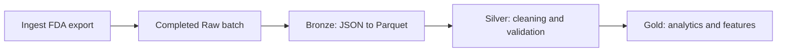

# openFDA Pipeline Design Doc

## Architecture Overview

The pipeline follows a four-stage data processing architecture: **Raw → Bronze → Silver → Gold**.

Each stage has a distinct responsibility, separating source preservation, storage optimization, data cleaning, and application-specific transformations.

Tasks form a DAG around these data layers. Ingestion publishes a completed Raw
batch; the independent Bronze node converts that batch without downloading data.
Bronze Parquet is a shared input for downstream Python or SQL/dbt tasks, each
owning its outputs. dbt requires a SQL engine that can access the Parquet data.
No orchestration framework is required by the conversion implementation.

### Raw Layer — Source Preservation

**Purpose:** Preserve original openFDA API responses exactly as received to ensure reproducibility, traceability, and recoverability.

**Responsibilities:**
- Store unmodified JSON responses from the openFDA API.
- Organize files by endpoint, ingestion date, and batch.
- Maintain ingestion metadata separately, including timestamps, source endpoints, and batch identifiers.
- Retain historical source responses to support reprocessing and auditing.

**Output:** Immutable, original JSON files.

#### Device enforcement ingestion node

- Implemented in `ingestion/device_enforcement.py`, callable through
  `ingest_device_enforcement(output_dir=Path("data/raw"), force=False)` or `ingest`.
  `backfill` delegates to the same downloader with `force=True`.
- Fetch the FDA download manifest and select all `/device/enforcement` partitions.
  Bulk updates are complete snapshots, including possible historical corrections.
- Match previous exports by export date, partition URLs, and record counts.
  Before skipping a matching completed batch, verify its local file checksums
  and metadata counts. These checks do not detect remote content revisions under
  an unchanged advertised identity; `--force` captures a fresh snapshot when needed.
- Preserve JSON bytes, validate ZIP integrity and counts, discard ZIPs, and publish
  only completed batches. Stage under `.ingest-*`; retain older snapshots unchanged.
- Stamp ingestion dates and timestamps in UTC using the existing Raw directory
  and metadata contract. Return the new batch path for downstream DAG tasks, or
  `None` when no new snapshot was published. Failure raises an error or exits
  nonzero from the CLI, leaving existing batches intact.
- Perform no format conversion or cleaning and invoke no downstream tasks.
  A future orchestrator passes the returned path to Bronze and retries failed
  downstream processing using the already published Raw batch. Scheduling is
  external to this node.

### Bronze Layer — Format Conversion

**Purpose:** Convert raw JSON records into a structured, columnar storage format for efficient downstream processing.

**Responsibilities:**
- Parse raw JSON responses and extract individual records.
- Convert JSON records into Apache Parquet format.
- Preserve source fields and values without applying business logic or data cleaning.
- Retain source identifiers and references to original raw files.
- Record schema information and conversion metadata.

**Output:** Parquet datasets representing the original source records.

#### Device enforcement conversion contract

- Implemented by `bronze/raw_to_bronze.py`, callable as
  `convert_batch(raw_batch_dir, output_dir)` or through `bronze --raw-batch ...`.
- The bare `bronze` command discovers completed batches under `data/raw/` and
  converts the sole batch missing its published Bronze counterpart. No pending
  batches is a successful no-op; multiple pending batches require explicit
  `--raw-batch` selection. Discovery uses the selected `--output-dir` root,
  ignores staging directories, and rejects existing destinations without
  conversion metadata. Explicit conversion remains available for DAG execution.
- Read files in ingestion-manifest order and verify SHA-256 checksums and file,
  partition, and batch counts. Process one JSON file at a time and write one
  Snappy-compressed Parquet file per source file.
- Schema version 1 covers all 25 observed source fields: 24 nullable strings and
  `openfda` encoded as nullable JSON text. Preserve dates, identifiers, blanks,
  whitespace, duplicate records, and row order. Reject unknown fields and
  incompatible non-null types pending an explicit schema update.
- Encode empty `openfda` objects as `"{}"`. Missing known fields and explicit JSON
  nulls become Parquet nulls; Raw remains authoritative for that distinction.
  Decode populated annotations with JSON when needed downstream.
- Add `_source_batch_id`, `_source_file`, and zero-based `_source_record_index`
  columns. Store source checksums, file mappings, counts, schema/version,
  converter/PyArrow versions, and UTC conversion timestamps separately in
  `conversion_metadata.json`.
- Mirror the Raw ingestion date and batch ID below
  `data/bronze/device_enforcement/`. Stage conversion outside Raw, validate each
  Parquet file by reading its schema and rows, then publish the complete batch
  with a directory rename. On failure, discard staging files. Reject existing
  output batches without overwriting them.
- Apply no cleaning or business-rule filtering. Silver performs standardization,
  deduplication, date parsing, and quality policies; Gold produces analytics and
  application-specific transformations.

### Silver Layer — Data Cleaning and Standardization

**Purpose:** Transform Bronze records into consistent, validated, analysis-ready datasets.

**Responsibilities:**
- Deduplicate records using appropriate source identifiers and versioning rules.
- Enforce data types, including dates, numeric fields, and categorical attributes.
- Handle missing values through documented, field-specific policies.
- Standardize manufacturer names, device categories, and relevant text fields.
- Validate data integrity, schema consistency, and accepted values.
- Flag or quarantine records that fail critical data quality checks.

**Output:** Cleaned and standardized Parquet tables.

### Gold Layer — Analytics and Business Logic

**Purpose:** Create curated datasets supporting domain-specific analytics, machine learning, and application features.

**Responsibilities:**
- Aggregate recall records by manufacturer, device category, classification, and time period.
- Calculate metrics and trends in reported recall activity.
- Generate machine learning features from structured and unstructured fields.
- Prepare model-ready datasets, including target variables and temporally appropriate training splits.
- Store model predictions and associated metadata.
- Create application-specific tables for dashboards and analytical queries.

**Output:** Curated analytical tables, ML feature datasets, and prediction results.
